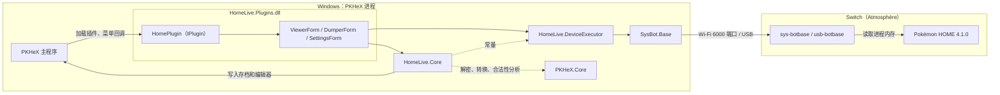
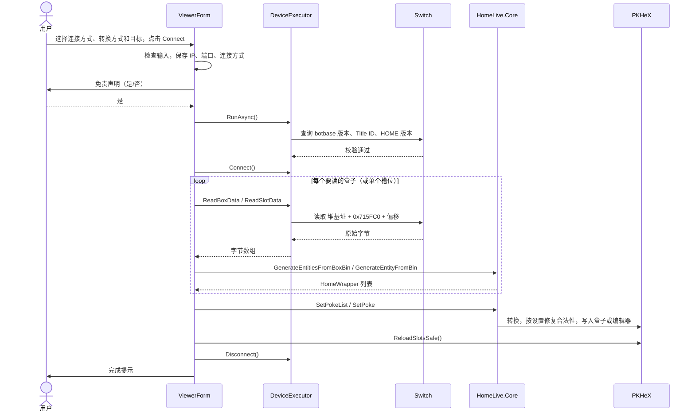

# HOME-Live-Plugin 项目文档

| 项目 | 内容 |
|---|---|
| 仓库 | [Manu098vm/HOME-Live-Plugin](https://github.com/Manu098vm/HOME-Live-Plugin) |
| 文档基线 | 提交 `f331cbcd`（2026-10-24），加上本分支对第 15 节问题的修复 |
| 插件版本 | 4.1.0（`HomePlugin.Version`） |
| 支持的 Pokémon HOME | Switch 版 4.1.0，Title ID `010015F008C54000` |
| PKHeX.Core | 26.10.18（NuGet） |
| 运行环境 | Windows，.NET 10，WinForms |
| 许可证 | GPLv3 |

本文依据源码、提交历史和 CI 配置整理。解决方案已在本机用 .NET SDK 10.0.115 编译（Debug、Release 均为 0 警告、0 错误），29 个单元测试全部通过；没有连接实机，文中关于运行时行为的描述是从代码推断的。

阅读指引：想快速了解项目，看第 1、2、6 节；要改代码，看第 7 至 10 节和第 13 节；第 15 节是代码审阅发现的问题及修复状态。

---

## 1. 项目定位

HOME-Live-Plugin 是 [PKHeX](https://github.com/kwsch/PKHeX) 的插件。它借助 Switch 上运行的 sys-botbase（Wi-Fi）或 usb-botbase（USB）读取 Pokémon HOME 进程的内存，取出盒子里的宝可梦数据，有两种用法：

- 导出（Dumper）：把 HOME 数据 1:1 存成文件，可选加密格式 `.ehN`、解密格式 `.phN`，或两者都存。
- 浏览（Viewer）：把 HOME 数据转换成当前存档所属游戏的 PKM 格式，直接放进 PKHeX 的编辑器或盒子。

插件只读，不写。README 写明不会支持向 HOME 写入或注入数据。

README 列出的用途：备份 HOME 里的全部宝可梦；HOME 会员过期后，访问第 1 个盒子以外的宝可梦；生成一份克隆放进本体游戏，原个体留在 HOME 里（保留 GO、HOME、Bank 标记）。

代码规模（基线 `f331cbcd`）：仓库有 77 个受控文件，C# 约 1 万行。其中 6,337 行是 `Legacy` 目录下从 PKHeX 历史版本移植的旧格式代码，约 1,500 行是 WinForms 设计器和资源的生成代码，手写的业务逻辑约 2,300 行。本分支另外加了一个测试项目（见第 4 节）。

## 2. 功能清单

| 入口 | 功能 | 实现位置 |
|---|---|---|
| 工具 → Home Live Plugins → Home Live Viewer | 读取 HOME 的单个槽位、单个盒子或一段盒子范围，转换后载入编辑器或盒子 | `ViewerForm` |
| 工具 → Home Live Plugins → Home Live Dumper | 导出单个槽位、单个盒子或全部 300 个盒子，格式可选加密、解密或两者 | `DumperForm` |
| Dumper 窗口的 Tools 菜单 | 批量解密文件、批量加密文件；加载单个文件到编辑器；加载多个文件或整个文件夹到盒子 | `DumperForm` |
| 工具 → Home Live Plugins → Home Live Plugins Settings | 默认 IP、端口、导出路径、连接方式、是否自动修复合法性 | `SettingsForm` |
| PKHeX 打开文件 | 通过 `IPlugin.TryLoadFile` 直接打开 `.ph*`、`.eh*`、`.pkh`、`.ekh` 文件 | `HomePlugin` → `DumperForm.TryLoadFile` |
| PKHeX 启动 | 查询 GitHub 最新 Release，有新版本时弹窗 | `GitHubUtil` |
| 界面语言 | 跟随 PKHeX 的语言设置，内置 10 种 | `WinFormsTranslator` |

Viewer 只在当前存档是以下类型时可用：Let's Go 皮卡丘/伊布（`SAV7b`）、剑/盾（`SAV8SWSH`）、晶灿钻石/明亮珍珠（`SAV8BS`）、传说 阿尔宙斯（`SAV8LA`）、朱/紫（`SAV9SV`）、传说 Z-A（`SAV9ZA`）。Dumper 不受存档类型限制。

## 3. 运行前提与使用步骤

运行前提：

- Switch 已破解并安装 Atmosphère。README 说明不支持 emuNAND 和模拟器。
- Switch 上运行 sys-botbase（Wi-Fi）或 usb-botbase（USB），版本不低于 2.4。版本过低时连接会被拒绝，错误信息里附带下载地址（`DeviceExecutor.BotbaseVersion`）。
- HOME 版本必须正好是 4.1.0。代码对版本字符串做相等比较（`HomeDataOffsets.HomeSupportedVersion`），HOME 一更新，插件就会拒绝连接，直到维护者更新偏移量。
- HOME 已联网并登录账号，打开后至少点一下屏幕（README）。不需要 HOME 会员。
- PKHeX 版本要和插件编译时使用的 PKHeX.Core 兼容。
- Wi-Fi 默认端口 6000。

使用步骤（README）：

1. 从 GitHub Releases 或 Project Pokémon 下载 `HomeLive.Plugins.dll`。Windows 下右键 → 属性 → 勾选"解除锁定"。
2. 放进 PKHeX 目录下的 `plugins` 文件夹，没有就新建。
3. 用受支持游戏的空白或默认存档打开 PKHeX，从"工具"菜单打开 Dumper 或 Viewer。
4. Switch 上打开 HOME，确认已联网登录，点一下屏幕。
5. 在插件里填 IP、选择盒子或槽位，点 Connect。

README 建议用空白存档，原因是 Viewer 的盒子模式和"加载到盒子"会先清空当前存档的全部盒子（见 7.2 节 `SaveFileHandler`）。

## 4. 技术栈与解决方案结构

`HomeLive.sln` 包含三个项目：

| 项目 | 目标框架 | 职责 | 外部依赖 |
|---|---|---|---|
| `HomeLive.DeviceExecutor` | `net10.0` | 与 Switch 通信：版本校验、地址计算、读内存 | `SysBot.Base.dll`（二进制，放在 `deps/`），NLog 5.4.0 |
| `HomeLive.Core` | `net10.0` | HOME 数据解析、格式转换、合法性修复、写入存档 | PKHeX.Core 26.10.18 |
| `HomeLive.Plugins` | `net10.0-windows7.0` | PKHeX 插件入口、三个窗口、多语言、更新检查 | Costura.Fody 5.7.0，LibUsbDotNet 2.2.29，Octokit 13.0.1 |
| `HomeLive.Tests` | `net10.0-windows7.0` | 单元测试：盒子范围、写入存档、文件命名、版本比较、盒子容量 | xunit 2.9.3，xunit.runner.visualstudio 3.1.5，Microsoft.NET.Test.Sdk 18.0.1 |

依赖方向是单向的：`HomeLive.Plugins` → `HomeLive.Core` → `HomeLive.DeviceExecutor`。Core 引用 DeviceExecutor 只用到 `HomeDataOffsets` 里的四个常量（头部长度、Seed 偏移、长度字段偏移、槽位大小），全部在 `PokeHandler` 里。

补充说明：

- `SysBot.Base.dll` 不走 NuGet，二进制直接提交在 `HomeLive.DeviceExecutor/deps/`（程序集版本 1.0.0.0，78,848 字节）。提交 `a8c90373`（#15）把它换成了与其他 PKHeX 插件相同的版本。
- Costura.Fody 在编译时把依赖嵌进 `HomeLive.Plugins.dll`。`FodyWeavers.xml` 排除了 `PKHeX.Core`，它由宿主 PKHeX 提供。所以发布物只有一个 DLL。
- `IGameDataSide3.cs` 用了 C# 14 的 `extension(...)` 扩展块，`DeviceExecutor` 用了主构造函数，编译需要 .NET 10 SDK。解决方案文件标注的是 Visual Studio 18。
- `.editorconfig` 把全部分析器诊断设为 `none`。
- 测试项目 `HomeLive.Tests` 是本分支新加的，测试框架和版本跟 PKHeX 自己的测试项目一致（没有引入 FluentAssertions）。

## 5. 目录结构

```text
HOME-Live-Plugin/
├─ HomeLive.sln
├─ .github/workflows/main.yml        CI：在 Windows 上构建并上传插件
├─ .editorconfig                     关闭全部分析器诊断
├─ README.md、LICENSE（GPLv3）
├─ HomeLive.DeviceExecutor/
│  ├─ DeviceExecutor.cs              DeviceState、DeviceExecutor<T>：连接、校验、读内存
│  ├─ HomeDataOffsets.cs             HOME 版本号、Title ID、槽位和盒子尺寸、内存偏移
│  └─ deps/SysBot.Base.dll           通信库（二进制）
├─ HomeLive.Core/
│  ├─ Classes/
│  │  ├─ HomeWrapper.cs              封装各版本 HOME 数据，提供到各游戏格式的转换
│  │  ├─ PokeHandler.cs              字节 → 实体、导出文件、文件命名
│  │  ├─ VersionHandler.cs           游戏版本归一、盒子容量、转换决策
│  │  ├─ SaveHandler.cs              写入 PKHeX 存档和编辑器（类名 SaveFileHandler）
│  │  ├─ LegalityHandler.cs          转换后的合法性修复
│  │  ├─ RangeHandler.cs             Viewer 盒子范围的划分和截取
│  │  └─ Legacy/PH1、PH2、PH3/        旧版 HOME 数据格式，移植自 PKHeX 历史提交
│  └─ Enums/Enums.cs                 DumpTarget、DumpFormat、ConversionType
├─ HomeLive.Plugins/
│  ├─ HomePlugin.cs                  IPlugin 实现，注册菜单
│  ├─ Forms/                         DumperForm、ViewerForm、SettingsForm
│  ├─ Utils/GitHubUtil.cs            更新检查
│  ├─ Utils/FormExtensions.cs        在窗体的 UI 线程上弹出提示框
│  ├─ Utils/WinFormsTranslator.cs    界面翻译，改编自 PKHeX
│  ├─ Properties/Settings.settings   用户设置
│  ├─ Resources/translations/        lang_*.txt，10 种语言
│  └─ FodyWeavers.xml                Costura 配置
└─ HomeLive.Tests/                   单元测试（xunit）
```

## 6. 整体架构



各层分工：

- Plugins 层管界面和流程：收集输入，创建 `DeviceExecutor`，把读到的字节交给 Core，最后刷新 PKHeX 界面。
- DeviceExecutor 层只负责"读哪段内存"：校验连接，计算地址，返回字节数组。它不解析宝可梦数据。
- Core 层不关心字节来自内存还是文件。输入是字节数组，输出是 PKHeX 的 `PKM` 对象、写进存档的结果或导出文件。
- 解密、格式转换和合法性分析交给 PKHeX.Core（`HomeCrypto`、`PKH`、`EntityConverter`、`LegalityAnalysis`）。插件自己维护的格式代码只有 DataVersion 1 至 3（`Legacy/PH1` 至 `PH3`），DataVersion 4 直接用 PKHeX.Core 的 `PKH`。

## 7. 模块详解

第一次读代码，建议顺序：`HomePlugin` → `ViewerForm.ConnectViewer` → `DeviceExecutor` → `PokeHandler` → `HomeWrapper` → `VersionHandler` → `SaveFileHandler` → `LegalityHandler`。`Legacy` 目录基本是 PKHeX 代码的副本，需要时再看。

### 7.1 HomeLive.DeviceExecutor

[DeviceExecutor.cs](../HomeLive.DeviceExecutor/DeviceExecutor.cs) 定义了三个类型：

| 类型 | 基类 | 说明 |
|---|---|---|
| `RoutineType` | 枚举 | `None`、`ReadWrite` |
| `DeviceState` | `BotState<RoutineType, SwitchConnectionConfig>` | 连接配置和当前例程状态 |
| `DeviceExecutor<T>` | SysBot.Base 的 `SwitchRoutineExecutor<T>` | 校验、地址计算、读内存 |

**连接校验**。表单先调用 `RunAsync()`，由 SysBot.Base 执行重写过的 `MainLoop`：

1. `VerifyBotbaseVersion`：版本低于 2.4 时抛异常，消息里给出 sys-botbase 或 usb-botbase 的下载链接。
2. `IsRunningHome`：当前 Title ID 必须是 `010015F008C54000`，`GetGameInfo("version")` 必须是 `"4.1.0"`，两种不匹配分别给出不同的错误信息。
3. Wi-Fi 模式下把 `SwitchConnection.MaximumTransferSize` 设为一个盒子的大小（0x330 × 30 = 24,480 字节），一次请求读完一个盒子。
4. 任一步骤失败都会 `Disconnect()`，再抛出 `InvalidOperationException`。

校验通过后，表单调用 `Connect()`，然后开始读数据。

**地址计算**（[HomeDataOffsets.cs](../HomeLive.DeviceExecutor/HomeDataOffsets.cs)）：

```text
盒子起始地址      = 堆基址 + 0x715FC0
盒子 b 的地址     = 盒子起始地址 + 0x330 × 30 × b
槽位 (b, s) 的地址 = 盒子 b 的地址 + 0x330 × s        （b、s 从 0 开始）
```

堆基址由 `GetHeapBaseAsync` 获取。算出的盒子起始地址缓存在静态字段 `BoxStartAddress` 里，`Disconnect()` 时清零。

| 常量 | 值 | 含义 |
|---|---|---|
| `HomeTitleID` | `010015F008C54000` | HOME 的 Title ID |
| `HomeSupportedVersion` | `4.1.0` | 唯一支持的 HOME 版本 |
| `HomeSlotSize` | `0x330`（816） | 内存中每个槽位的字节数 |
| `HomeSlotCount` | 30 | 每个盒子的槽位数 |
| `HomeBoxCount` | 300 | 盒子总数 |
| `HeaderLength` | `0x10` | 实体头部长度 |
| `SeedOffset` | `0x02` | 头部中 EncryptionSeed 的偏移 |
| `EncSizeOffset` | `0x0E` | 头部中 EncodedDataSize 的偏移 |
| `BoxStartOffset` | `0x715FC0` | 盒子数据相对堆基址的偏移 |

300 个盒子共 9,000 个槽位，全部读完是 7,344,000 字节（约 7.0 MiB）。

**读取接口**：

| 方法 | 读取长度 | 使用者 |
|---|---|---|
| `ReadSlotData(box, slot)` | 0x330 | Viewer、Dumper 的单槽位模式 |
| `ReadBoxData(box)` | 0x5FA0（30 个槽位） | 单盒子、盒子范围、全部导出 |
| `ReadRange(start, end)` | 起止槽位之间 | 没有调用方 |

### 7.2 HomeLive.Core

#### HomeWrapper

[HomeWrapper.cs](../HomeLive.Core/Classes/HomeWrapper.cs) 把不同版本的 HOME 数据包成一个对象，对外提供解密数据（`Data`）、加密数据（`EncryptedData`）、`Tracker` 和到各游戏格式的转换。

构造时读前 2 字节的 DataVersion，选择解析类：

| DataVersion | 解析类 | 来源 |
|---|---|---|
| 1 | `PH1` | `Legacy/PH1`，移植自 PKHeX 提交 `be88ec38` |
| 2 | `PH2` | `Legacy/PH2`，移植自 `75ec6ca3` |
| 3 | `PH3` | `Legacy/PH3`，移植自 `e41797d0` |
| 4 | `PKH` | PKHeX.Core |
| 其他 | 无 | 交给 `EntityFormat.GetFromBytes`，按普通 PKM 文件识别 |

解析结果被判为无效时，同样回落到 `EntityFormat.GetFromBytes`（有效性判断的问题见第 15 节第 7 条）。

各格式能携带的游戏附加数据：

| | PB7 | PK8 | PB8 | PA8 | PK9 | PA9 | PC9 |
|---|---|---|---|---|---|---|---|
| PH1 | ✓ | ✓ | ✓ | ✓ | | | |
| PH2 | ✓ | ✓ | ✓ | ✓ | ✓ | | |
| PH3 | ✓ | ✓ | ✓ | ✓ | ✓ | ✓ | |
| PKH | ✓ | ✓ | ✓ | ✓ | ✓ | ✓ | ✓ |

PB7 对应 Let's Go，PK8 对应剑/盾，PB8 对应晶灿钻石/明亮珍珠，PA8 对应传说 阿尔宙斯，PK9 对应朱/紫，PA9 对应传说 Z-A。PC9 是 PKHeX.Core 中 `HomeGameDataFormat.PC9` 对应的数据块，插件只在向后转换里用到它，Viewer 没有为它开放。

转换方法成对出现：`HasXX()` 判断是否已有该游戏的附加数据，`ConvertToXX()` 生成该格式的 PKM。对 PH1 至 PH3 和 PKH，没有附加数据时 `ConvertToXX()` 会用已有的其他附加数据临时生成一份（`TryCreate`）；对已经是普通 PKM 的对象，调用 PKHeX 的 `EntityConverter.ConvertToType`。

`BackwardTransfer(destType)` 处理 HOME 附加数据之外的目标格式（例如第 7 世代的 PK7）：按 PK8、PB7、PB8、PA8、PK9、PA9、PC9 的顺序找第一份可用的附加数据，先转成该格式，再交给 `EntityConverter.ConvertToType` 转成目标格式。PK8 排第一，是因为从 Bank 传入的宝可梦默认带 PK8 数据（代码注释）。能否转成功取决于 PKHeX 的 `EntityConverter` 规则。

#### PokeHandler

[PokeHandler.cs](../HomeLive.Core/Classes/PokeHandler.cs) 负责字节与实体之间的转换，以及导出文件：

- `GenerateEntityFromBin`：前 0x10 字节是头部。`0x02` 处的 8 字节 EncryptionSeed 为 0 时视为空槽位，返回 `null`；否则截取 `0x10 + EncodedDataSize` 字节交给 `HomeWrapper`。
- `GenerateEntitiesFromBoxBin`：把一个盒子的字节按 0x330 切开，返回 30 个元素的列表，空槽位为 `null`。
- `Dump`：创建目录，按 `DumpFormat` 写 `.eh{DataVersion}` 和/或 `.ph{DataVersion}`。加密文件由解密数据经 `HomeCrypto.Encrypt` 重新加密得到。
- `GetFileName`：生成文件名，规则见 9.3 节。
- `CompatibleFormats`：可识别的扩展名，即 `.ph1` 至 `.ph4`、`.eh1` 至 `.eh4`、`.pkh`、`.ekh`。

#### VersionHandler

[VersionHandler.cs](../HomeLive.Core/Classes/VersionHandler.cs) 分三块：

- 版本归一：`GP`、`GE` 归为 `GG`，`SW`、`SH` 归为 `SWSH`，`BD`、`SP` 归为 `BDSP`，`SL`、`VL` 归为 `SV`，`PLA`、`ZA` 不变。也能从 PKM 类型反推游戏，比如 `PB7` 对应 `GG`。
- 本地盒子容量：Let's Go 40 × 25，剑/盾 32 × 30，晶灿/明亮 40 × 30，阿尔宙斯 32 × 30，朱/紫 32 × 30，Z-A 32 × 30。Viewer 用它划分盒子范围。
- 转换决策：`ConvertToType` 根据 `ConversionType` 决定是否转换，详见第 10 节。物种和形态是否存在于目标游戏，由 `PersonalTable.XX.IsPresentInGame(species, form)` 判断。

#### RangeHandler

[RangeHandler.cs](../HomeLive.Core/Classes/RangeHandler.cs) 是本分支从 `ViewerForm` 里抽出来的，方便测试：

- `GetDownloadRanges`：按本地存档的容量把 HOME 盒子切成若干段，见 8.2 节。
- `GetEntriesInRange`：给定某个 HOME 盒子的 30 个元素，返回落在段内的部分。一段的第一个和最后一个盒子可能只取一部分。

#### SaveFileHandler

[SaveHandler.cs](../HomeLive.Core/Classes/SaveHandler.cs)（文件名与类名不一致，类名是 `SaveFileHandler`）把转换结果写进 PKHeX：

- `SetPoke`：转换单个实体，`AdaptToSaveFile` 之后填进 PKM 编辑器。
- `SetPokeList`：转换整个列表。只要列表不为空，先调用 `sav.ClearBoxes()` 清空当前存档的**全部**盒子，再从盒子 1 槽位 1 开始顺序写入，写满全部盒子后忽略多出来的元素。转换结果为 `null` 的元素不写，但仍占一个位置，所以 HOME 里的空位在本地也是空位。
- `ReloadSlotsSafe`、`PopulateFieldsSafe`：通过 `dynamic` 调用 `InvokeRequired` 和 `Invoke`，保证在 UI 线程上刷新 PKHeX 界面。

两个写入方法都受"自动修复合法性"设置控制，开启时写入前先调用 `FixLegality()`。

#### LegalityHandler

[LegalityHandler.cs](../HomeLive.Core/Classes/LegalityHandler.cs) 的 `FixLegality()` 只处理 `LegalityAnalysis` 判为非法的个体：在副本上依次执行修复步骤，修复后副本完全合法才返回副本，否则返回原对象。步骤见 10.2 节。

#### Enums

| 枚举 | 值 |
|---|---|
| `DumpTarget` | `TargetBox`、`TargetSlot`、`TargetAll` |
| `DumpFormat` | `Encrypted`、`Decrypted`、`EncAndDec` |
| `ConversionType` | `SpecificData`、`CompatibleData`、`AnyData` |

### 7.3 HomeLive.Plugins

#### HomePlugin

[HomePlugin.cs](../HomeLive.Plugins/HomePlugin.cs) 实现 PKHeX 的 `IPlugin`，`Name` 为 `HomePlugin`，`Priority` 为 1：

- `Initialize`：生成并翻译字符串表 → 同步执行更新检查（`Task.Run(TryUpdate).Wait()`，请求最多 5 秒，出错不影响加载）→ 从参数里取 `ISaveFileProvider`、`IPKMView` 和主菜单 → 在 `Menu_Tools` 下挂 "Home Live Plugins" 子菜单，含 Viewer、Dumper、Settings 三项 → 调用 `NotifySaveLoaded`。
- `NotifySaveLoaded`：刷新语言；存档是 `SAV7b`、`SAV8SWSH`、`SAV8BS`、`SAV8LA`、`SAV9SV`、`SAV9ZA` 之一时启用 Viewer，否则禁用。
- `NotifyDisplayLanguageChanged`：PKHeX 切换界面语言时重新翻译菜单。
- `TryLoadFile(path)`：转给 `DumperForm.TryLoadFile`。路径是文件夹时整体加载到盒子，是兼容扩展名的文件时载入编辑器。

#### 窗口

| 窗口 | 输入 | 动作 |
|---|---|---|
| `DumperForm` | 连接方式、IP、端口；导出对象（指定盒子、指定槽位、全部）；导出格式；导出目录；"为盒子创建文件夹" | 读取并导出；Tools 菜单提供文件解密、加密、加载到编辑器、加载到盒子 |
| `ViewerForm` | 连接方式、IP、端口；转换方式；目标（盒子范围、指定盒子、指定槽位） | 弹出免责声明，同意后读取、转换并写入存档 |
| `SettingsForm` | 默认 IP、端口、路径、连接方式、自动修复合法性 | 保存到用户设置 |

点击 Connect 时，两个读取窗口会检查必填项（连接方式、IP、端口；Dumper 还有导出对象、格式和目录，Viewer 还有转换方式），并把 IP、端口、连接方式写回设置，Dumper 另外保存导出目录。读取期间输入控件被禁用，进度条显示进度。

#### 工具类

- [WinFormsTranslator.cs](../HomeLive.Plugins/Utils/WinFormsTranslator.cs)：改编自 PKHeX 的同名类，规则见 11.2 节。
- [GitHubUtil.cs](../HomeLive.Plugins/Utils/GitHubUtil.cs)：更新检查，见 11.3 节。
- [FormExtensions.cs](../HomeLive.Plugins/Utils/FormExtensions.cs)：`ShowMessageSafe` 在窗体的 UI 线程上弹出提示框，窗体已关闭时退回普通提示框。

## 8. 关键流程

### 8.1 Viewer：读取并导入



三种目标的区别：

- 指定槽位：读 1 个槽位，结果填进 PKM 编辑器，不动盒子。
- 指定盒子：读 1 个 HOME 盒子（30 个槽位），清空本地全部盒子后从盒子 1 开始写。Let's Go 每盒 25 格，这 30 个会占满盒子 1 和盒子 2 的前 5 格。
- 盒子范围：按 8.2 节的划分读取多个 HOME 盒子，清空本地全部盒子后顺序写入。

### 8.2 盒子范围的划分

`RangeHandler.GetDownloadRanges` 以本地存档的总容量为单位，把 HOME 的 9,000 个槽位切成若干段，每段正好填满一个本地存档：

| 存档 | 本地容量 | 段数 | 第一段 | 最后一段 |
|---|---|---|---|---|
| Let's Go | 40 × 25 = 1,000 | 9 | 盒子 1 至盒子 34 槽位 10 | 盒子 267 槽位 21 至盒子 300 |
| 剑/盾、阿尔宙斯、朱/紫、Z-A | 32 × 30 = 960 | 10 | 盒子 1 至盒子 32 | 盒子 289 至盒子 300 |
| 晶灿/明亮 | 40 × 30 = 1,200 | 8 | 盒子 1 至盒子 40 | 盒子 281 至盒子 300 |

960 和 1,200 都是 30 的整数倍，所以每段由整数个 HOME 盒子组成。Let's Go 的 1,000 不是，段的起止会落在盒子中间，首尾两个盒子由 `RangeHandler.GetEntriesInRange` 截取。基线版本在这里有偏差，见第 15 节第 1 条（已修复）。

### 8.3 Dumper：导出

连接校验与 Viewer 相同，不弹免责声明。之后按导出对象处理：

- 指定槽位：读 1 个槽位，导出为文件。
- 指定盒子：读 1 个盒子，导出其中非空的槽位。
- 全部：依次读 300 个盒子。勾选"为盒子创建文件夹"时，每个盒子写到 `<目录>/<盒子> 001` 这样的子目录。"盒子"一词随界面语言变化，英文界面是 `Box 001`。

导出不经过格式转换和合法性修复。

### 8.4 从文件加载

入口有两类：Dumper 的 Tools 菜单（Load file to Editor、Load files to Boxes、Load folder to Boxes），以及 PKHeX 调用 `IPlugin.TryLoadFile`。

- 单个文件：扩展名在 `CompatibleFormats` 里时解析并填进编辑器。
- 多个文件或文件夹：文件夹会递归遍历子目录。兼容文件按枚举顺序组成列表，交给 `SetPokeList`，同样先清空全部盒子再写入。
- 文件加载固定用 `ConversionType.AnyData`，不检查物种是否存在于目标游戏，是否修复合法性跟随设置。目标格式不属于 HOME 附加数据格式时（例如第 7 世代及更早的存档），走 `BackwardTransfer`。

Tools 菜单里的 Decrypt from files 和 Encrypt from files 会解析选中的文件，再以另一种格式写到用户选择的目录，可用来在 `.ehN` 和 `.phN` 之间互转。

## 9. 数据格式

### 9.1 单个槽位

内存里每个槽位占 0x330 字节，实体本身的长度是 `0x10 + EncodedDataSize`，后面剩余的字节不使用。头部 16 字节是明文（插件在解密前就直接读取其中的 DataVersion、EncryptionSeed 和长度）；之后的数据由 PKHeX.Core 的 `HomeCrypto` 加解密，实体总长按 16 字节对齐（PKCS7 填充，见 `PH3.Rebuild`）。解密后的布局如下，字段名取自 `PH3`：

| 偏移 | 长度 | 字段 | 说明 |
|---|---|---|---|
| 0x00 | 2 | `DataVersion` | 格式版本，决定解析类 |
| 0x02 | 8 | `EncryptionSeed` | 为 0 表示空槽位 |
| 0x0A | 4 | `Checksum` | |
| 0x0E | 2 | `EncodedDataSize` | 头部之后的数据长度 |
| 0x10 | 2 | `CoreDataSize` | |
| 0x12 | `CoreDataSize` | Core 数据 | 各游戏通用的字段：物种、个体值、努力值、训练家、记忆、缎带等（`GameDataCore`） |
| 0x12 + `CoreDataSize` | 2 | `GameDataSize` | |
| 其后 | `GameDataSize` | 附加数据块 | 每块由 1 字节格式 ID、2 字节长度和数据组成，存放招式、球种、遇见地点等游戏专属字段 |

从 GO 导入的个体可以没有任何附加数据块（`PH3.ReadGameData1` 的注释）。

### 9.2 旧格式

| DataVersion | 类 | 移植来源（PKHeX 提交） | 扩展名 | 附加数据 | `IsValid` 的物种上限 |
|---|---|---|---|---|---|
| 1 | `PH1` | `be88ec38` | `.ph1` / `.eh1` | PB7、PK8、PB8、PA8 | Enamorus |
| 2 | `PH2` | `75ec6ca3` | `.ph2` / `.eh2` | 增加 PK9 | Iron Leaves |
| 3 | `PH3` | `e41797d0` | `.ph3` / `.eh3` | 增加 PA9 | Pecharunt |
| 4 | `PKH`（PKHeX.Core） | 无 | `.ph4` / `.eh4` | 增加 PC9 | `Species.MAX_COUNT` 以内 |

有了这些类，插件仍能读取旧版插件导出的 `.ph1` 至 `.ph3`、`.eh1` 至 `.eh3` 文件。`HomeWrapper` 对内存和文件里的数据一视同仁，都按 DataVersion 选类。

### 9.3 导出文件命名

```text
{物种编号 4 位}[-{形态 2 位}][-{形态参数 2 位}][ ★| ■][ (GMax)][ (Alpha)][ (Noble)] - {昵称} {Tracker 16 位十六进制}.{ph|eh}{DataVersion}
```

- 形态：`Form > 0` 时追加。霜奶仙（Alcremie）总是追加形态和形态参数。
- 闪光：`ShinyXor == 0` 或 `FatefulEncounter` 为真时用 `■`，其余闪光用 `★`。
- `(GMax)`：带剑/盾附加数据且能超极巨化。
- `(Alpha)`：带阿尔宙斯或 Z-A 附加数据，并且是头目宝可梦。`(Noble)`：带阿尔宙斯附加数据，并且是王。基线版本里这两个后缀从不出现，见第 15 节第 3 条（已修复）。
- 昵称里 Windows 文件名不允许的字符 `\ / : * ? " < > |` 会被去掉。

示例（Tracker 是虚构的）：`0025 - Pikachu 0123456789ABCDEF.ph4`、`0869-03-05 ★ - Alcremie 0123456789ABCDEF.eh4`。

## 10. 转换策略与合法性修复

### 10.1 三种转换方式

| 简体中文界面的选项 | 控件 | 枚举 | 何时转换 |
|---|---|---|---|
| 仅在游戏版本中有物种数据时转换 | `radioConvertSpecific` | `SpecificData` | HOME 里已有目标游戏的附加数据，且物种和形态存在于目标游戏 |
| 如果与存档文件兼容，则转换成任意PKM数据 | `radioConvertForce` | `CompatibleData` | 物种和形态存在于目标游戏即可，没有附加数据时临时生成 |
| 转换成任意PKM数据（非法） | `radioConvertAny` | `AnyData` | 一律转换，结果可能不合法 |

英文界面的对应文字是 "Convert only if game specific data already exists"、"Convert any PKM data if compatible with the current game"、"Convert any PKM data (illegal)"。控件名叫 `radioConvertForce`，对应的却是 `CompatibleData` 而不是 `AnyData`，读代码时容易看错。

决策逻辑（`VersionHandler.ConvertToType`，伪代码）：

```text
T     = 当前存档的 PKM 类型
force = (方式 == AnyData) 或 (方式 == CompatibleData 且 物种和形态存在于 T 的游戏)

若 T 是 PB7、PK8、PB8、PA8、PK9、PA9 之一:
    若 (已有 T 的附加数据 且 物种和形态存在于 T 的游戏) 或 force: 转换
    否则: 返回 null，该槽位留空
否则若 T 不属于 HOME 附加数据格式（例如 PK7）: BackwardTransfer
否则: 返回 null
```

### 10.2 合法性修复

开关是设置项 `fix_legality`，默认开启，作用于 Viewer 和从文件加载，不影响导出。修复在副本上进行，修复后完全合法才采用。步骤依次为：

| 步骤 | 适用对象 | 处理 |
|---|---|---|
| `Heal` | 全部 | PKHeX 的 `Heal()` |
| `FixCopyHeight` | PA8 | 遭遇检查有非法项时，尝试令 `Scale = HeightScalar`，非法项减少才保留（代码注释：多数由 PH1 转出的 PA8，`Scale` 为 0） |
| `FixConversionSV` | 来源为朱/紫的 PK8 | 版本改为剑或盾，遇见地点改为 `LocationsHOME.SWSL` 或 `SHVL` |
| `FixConversionPLA` | 来源为阿尔宙斯 | 特性非法时按遭遇修正特性序号；PK8 改为剑，地点改为 `SWLA`，蛋地点 65534 改为 0 |
| `FixConversionBDSP` | 来源为晶灿/明亮 | PB8 蛋地点为 0 时改为 65535；PK8 改为剑或盾，地点改为 `SWBD` 或 `SHSP`，必要时清除蛋地点 |
| `FixConversionLGPE` | PB7 | 修正特性序号；遭遇为 WB7 配信卡 9028 时，按 HOME 规则重设身高、体重的绝对值；`ResetCP()` |
| `FixMoveSet` | 全部 | 招式或回忆招式非法时换成 PKHeX 建议的招式；恢复 PP |

Viewer 连接前的免责声明交代了转换的性质：它是对官方传输的非官方模拟，结果至多算合法（legal），不能算正规（legitimate）个体，也不应拿这些文件向 PKHeX 报告合法性问题。

## 11. 配置与多语言

### 11.1 用户设置

| 设置项 | 类型 | 默认值 | 用途 |
|---|---|---|---|
| `ip_address` | string | `192.168.1.1` | Wi-Fi 连接的 IP |
| `port` | int | 6000 | 端口 |
| `USB` | bool | False | 是否使用 USB |
| `path` | string | 空 | Dumper 导出目录 |
| `fix_legality` | bool | True | 自动修复合法性 |
| `def_language` | string | `en` | 代码中没有使用 |

全部是 user 作用域，由 .NET 的应用设置机制按 Windows 用户分别保存。

### 11.2 界面翻译

- 语言代码取自 PKHeX 的 `GameInfo.CurrentLanguage`，在存档加载和 PKHeX 切换语言时刷新。
- 查找顺序：进程当前目录下的 `lang_{代码}.txt`（通常就是 PKHeX.exe 所在目录）→ 内嵌资源 `lang_{代码}` → 把 `-` 换成 `_` 之后的资源名。外部文件依次尝试 UTF-8、windows-1252、Latin1 解码。
- 文件格式是每行一条 `键=值`。没有 `=` 的行被忽略，同一个键以第一次出现的为准。
- 键的命名：窗口标题用窗体名（如 `DumperForm`），控件用 `窗体名.控件名`（如 `DumperForm.btnConnect`），代码里用到的文本用 `Plugin.*`、`Warning.*`、`Word.*`、`Action.*`、`Update.*` 等前缀。
- 缺键时两类文本的表现不同：控件保留设计器里的英文；代码文本的默认值是空字符串，缺键就显示为空。所以每个语言文件都必须包含全部键。目前 10 个文件（de、en、es、es-419、fr、it、ja、ko、zh-Hans、zh-Hant）的键完全一致，都是 86 个。
- 翻译结果按语言缓存在静态字典里。想改译文又不重新编译，可以把 `lang_zh-Hans.txt` 放到 PKHeX.exe 旁边，重启 PKHeX 后生效。
- 新增语言：添加 `lang_xx.txt`，并在 `Properties/Resources.resx` 里登记同名资源。

### 11.3 更新检查

`Initialize` 时同步执行：用 Octokit 匿名调用 GitHub API，取 `Manu098vm/HOME-Live-Plugin` 的最新 Release，把 Release 的**名称**（名称为空时用标签名）与 `HomePlugin.Version` 比较；有新版本时弹窗，点"是"打开 Releases 页面。请求超时 5 秒；网络出错、解析不出版本号或弹窗出错，都按"没有更新"处理，不影响插件加载。版本号按数字比较，`4.10.0`、`v4.2.0`、`4.2.0 - 说明文字` 这类写法都能识别（`GitHubUtil.IsNewerVersion`）。基线版本的问题见第 15 节第 4 条。

## 12. 构建、CI 与发布

### 12.1 本地构建

需要 Windows 和 .NET 10 SDK（插件项目的目标是 `net10.0-windows7.0`）。下面两条命令已在本机执行过（SDK 10.0.115，Release 编译 0 警告、0 错误，29 个测试全部通过）：

```powershell
dotnet build HomeLive.sln -c Release
```

```powershell
dotnet test HomeLive.sln
```

产物在 `HomeLive.Plugins\bin\Release\net10.0-windows7.0\`，部署时只需要其中的 `HomeLive.Plugins.dll`，放进 PKHeX 的 `plugins` 文件夹。

本地构建引用的是 NuGet 上的 PKHeX.Core 26.10.18。如果要配合更新的 PKHeX，需要升级这个包，或者照 CI 的做法替换 DLL。

如果仓库放在 PKHeX 源码目录下面（例如 `PKHeX/PKHeX-Plugins/HOME-Live-Plugin`），本地构建会继承上级目录的 `Directory.Build.props` 和 `global.json`：程序集版本和产品名变成 PKHeX 的（实测为 26.10.18.0 和 "PKHeX"），`LangVersion` 固定为 14，SDK 按 `global.json` 选择。插件功能不受影响，更新检查用的是 `HomePlugin.Version` 常量。CI 单独检出本仓库，不受这些文件影响。

### 12.2 CI

[.github/workflows/main.yml](../.github/workflows/main.yml) 在推送到 `master` 或向 `master` 提 PR 时运行，环境是 `windows-latest` 和 .NET 10：

1. 检出本仓库，再把 `kwsch/PKHeX` 的 `master` 检出到 `PKHeX/`，编译 PKHeX.Core（Release）。
2. 对本解决方案执行 `dotnet restore`。
3. 用刚编译出的 `PKHeX.Core.dll` 覆盖 NuGet 缓存中 `pkhex.core` 最新版本的 `lib/net10.0/PKHeX.Core.dll`。
4. `dotnet build --configuration Release --no-restore`。
5. 把 `HomeLive.Plugins/bin` 上传为构建产物 `HomeLive.Plugins`，排除 `PKHeX.Core.dll`。

所以 CI 产物是对着 PKHeX `master` 当时的代码编译的，和本地对着 26.10.18 编译的结果可能不同。工作流只上传产物，不创建 Release。测试项目在解决方案里，CI 的 `dotnet build` 会一并编译它，但工作流里没有 `dotnet test` 步骤。

### 12.3 发版

从提交历史看，发版的固定动作是修改 `HomePlugin.Version`（提交信息通常是 "Bump version"）并打同名标签。更新检查读的是 Release 名称，所以 Release 名称要写成 `X.Y.Z`，而且每段只能是一位数。发布渠道是 GitHub Releases 和 Project Pokémon 的文件页（README）。

## 13. 适配新版本 HOME

HOME 每次更新都会让插件失效（版本号相等校验），需要发新版。历次适配的数据：

| HOME 版本 | 盒子定位方式 | 槽位大小 | 盒子数 | 对应提交 |
|---|---|---|---|---|
| 3.2.1 | 指针链 `[0x8D6E78, 0x08, 0x58]`（`PointerAll`） | 0x2D0（720） | 200 | `79581847` 之前 |
| 4.0.0 | 堆基址 + `0x4C0130` | 0x330（816） | 200 | `79581847`（2026-04-03） |
| 4.1.0 | 堆基址 + `0x715FC0` | 0x330（816） | 300 | `ac8973ce`（2026-10-24） |

适配清单：

1. 把 `HomeDataOffsets.HomeSupportedVersion` 改成新版本号。
2. 重新定位盒子数据，更新 `BoxStartOffset`。如果要改回指针链方式，旧实现可以在 `79581847` 的 diff 里找到。仓库没有记录偏移量是怎么找出来的。
3. 核对 `HomeSlotSize` 和 `HomeBoxCount`。两个窗口的盒子、槽位下拉框都由这两个常量生成，`RangeHandler.GetDownloadRanges` 也依赖它们。
4. HOME 数据格式升级（DataVersion 加 1）时：
   - 先升级 PKHeX.Core，新格式由它的 `PKH` 支持；
   - 从 PKHeX 历史提交复制上一版本的 `PKH`、`GameDataCore`、各 `GameDataXX`、`HomeOptional`、`IGameDataSide` 到 `Legacy/PHn/`，类名加版本后缀，文件头注明来源提交；
   - 在 `HomeWrapper` 构造函数的 switch、各 `HasXX` 和 `ConvertToXX`、`GetIsValid`、`GetDataVersion` 里加入新类；
   - 在 `PokeHandler.CompatibleFormats` 里加入新扩展名。

   提交 `2240085d`（Legacy PH3 format）是一次完整的示例。
5. 支持新游戏：改 `VersionHandler`（容量、版本归一、`PersonalTable`）、`HomeWrapper`（`HasXX`、`ConvertToXX`、`BackwardTransfer`）和 `HomePlugin.NotifySaveLoaded`（启用 Viewer 的存档类型）。参考 `d69bdc8f`（ZA 初步支持）。
6. 跟进 PKHeX.Core 的 API 变化，例如 `b08e81e0`（`StatNature` 改名为 `StatAlignment`）和 `4eb45d24`（缎带相关改动）。
7. 新增界面文本时，10 个 `lang_*.txt` 都要补上对应的键。
8. 运行 `dotnet test`，确认测试仍然通过。
9. 修改 `HomePlugin.Version` 和 README，打标签发布。

## 14. 版本演进

| 时间 | 事件 |
|---|---|
| 2020-12-19 | 首次发布 |
| 2023-01 至 2023-12 | 2.0.5 至 3.2.1 |
| 2024-06-09 | 通信代码拆成独立项目 `HomeLive.DeviceExecutor`；盒子地址从固定偏移改为指针定位 |
| 2024-06-10 | 西班牙语翻译（#12） |
| 2024-11 | 修复简繁中文翻译加载（#14）；升级 .NET 9 |
| 2024-12-24 | SysBot.Base 与其他插件对齐（#15） |
| 2025-05-16 | 加入 botbase 版本检查 |
| 2025-06-21 | 只在 Wi-Fi 模式检查连接状态；改为校验 HOME 应用版本号，不再校验 build id |
| 2025-08-31 | 适配 PKHeX 新的方法签名，去掉大部分 `dynamic`（`SaveFileHandler` 里还有两处） |
| 2025-09-11 | 支持向后转换 |
| 2026-01-11 | 升级 .NET 10（#16） |
| 2026-04-02 | 加入 Legacy PH3 格式；传说 Z-A 初步支持 |
| 2026-04-03 | 适配 HOME 4.0.0：改用堆基址加偏移，槽位变为 0x330 |
| 2026-04-07 | 加入 PC9 |
| 2026-04-27 | 发布 4.0.0 |
| 2026-06-17 | 跟进 PKHeX：`StatNature` 改为 `StatAlignment`（#20） |
| 2026-09-07 | 发布 4.0.1 |
| 2026-10-21 | 跟进 PKHeX 的缎带改动（#21） |
| 2026-10-24 | 发布 4.1.0：适配 HOME 4.1.0（300 个盒子、新偏移），PKHeX.Core 升到 26.10.18，新增 es-419 翻译 |

标签：2.0.5、2.1.0、2.1.1、3.0.0、3.1.0、3.1.1、3.2.1 至 3.2.9、3.3.0、4.0.0、4.0.1、4.1.0。

`master` 历史共 135 个提交。维护者 Manu098vm 以 Manu、Manu098VM、Manu098vm 三个身份提交，合计 122 个；其余来自 DOTTEL Gaël（4）、Archit Date（3）、Eelen（2）、Professor Dirty（2）、NEKpewar（1）和 8CBCA403（1）。README 还致谢了 SciresM（HOME 加密研究）、kwsch（PKHeX、SysBot.NET）、olliz0r 和 berichan（sys-botbase）、fishguy6564 和 Koi-3088（usb-botbase）以及 PP-theSLAYER（HOME 研究）。

## 15. 代码审阅发现与修复状态

以下问题最初来自阅读基线代码（`f331cbcd`），按影响从大到小排列。本分支修复了第 1 至 6 条和工程层面的几处小问题，第 7 条有意不改。能写单元测试的都先写了复现测试，确认在旧代码上失败、修复后通过；涉及界面线程的改动只经过编译和代码审阅。所有改动都没有在实机上运行过。

| 条目 | 状态 | 验证方式 |
|---|---|---|
| 1 | 已修复 | `RangeHandlerTests` |
| 2 | 已修复 | `SaveFileHandlerTests` |
| 3 | 已修复 | `PokeHandlerFileNameTests` |
| 4 | 已修复 | `GitHubUtilTests`；超时设置只经过编译 |
| 5 | 已修复 | 编译、代码审阅 |
| 6 | 已修复 | 编译、代码审阅 |
| 7 | 未修改 | 原因见该条 |

**1. Let's Go 存档下，Viewer 的盒子范围从第 2 段起会错位**

位置：基线 `ViewerForm.cs` 第 392 至 404 行

读取循环没有用到 `start.slot`，截断最后一个盒子的条件 `i == end.box - 1` 也只在 `start.box == 1` 时成立。以第 2 段"盒子 34 槽位 11 至盒子 67 槽位 20"为例，实际读入的是盒子 34 槽位 1 至盒子 67 槽位 30，共 1,020 个：开头多了 10 个属于上一段的个体，结尾多了 10 个，本该在第 1 格的个体被挤到第 11 格。其他游戏每段都是整数个 HOME 盒子，不受影响。

修复：盒子范围的划分和截取移到 [RangeHandler.cs](../HomeLive.Core/Classes/RangeHandler.cs#L45-L55)。`GetEntriesInRange` 在一段的第一个盒子跳过 `start.slot - 1` 个元素，在最后一个盒子只取到 `end.slot`；`ViewerForm` 逐个盒子调用它（[ViewerForm.cs#L361-L372](../HomeLive.Plugins/Forms/ViewerForm.cs#L361-L372)），进度条的算法也一并改掉，不会再出现除以零。测试 `RangeHandlerTests` 在旧逻辑下第 2、3、9 段都得到 1,020 个元素；修复后第 1、2、3、9 段都正好是 1,000 个，首尾槽位与段的起止一致。

**2. `SetPokeList` 的边界判断差一**

位置：[SaveHandler.cs#L29](../HomeLive.Core/Classes/SaveHandler.cs#L29)

`if (i > (numBox * numSlot)) break;` 应为 `>=`。列表长度超过存档容量时（上一条的情况，或用"加载文件夹到盒子"导入超过容量的文件），下标为 `numBox * numSlot` 的元素会以盒子号 `numBox` 写入，超出存档的盒子范围。PKHeX 的 `SetBoxSlotAtIndex` 不检查盒子号。朱/紫存档的盒子数据块里，紧跟在 32 个盒子后面的是坐骑传说宝可梦（故勒顿/密勒顿，`Box9.RideLegend`），多出来的这个个体会直接覆盖它。

修复：改为 `>=`。测试 `SaveFileHandlerTests` 往空白朱/紫存档写入 961 个个体：旧代码下坐骑数据从第 6 字节起被改写，修复后保持不变。

**3. 文件名里的 `(Alpha)` 和 `(Noble)` 永远不会出现**

位置：基线 `PokeHandler.cs` 第 86 至 89 行

判断的对象 `pkh` 是 `HomeWrapper`，这个类不实现 `IAlpha` 和 `INoble`，条件恒为假。HOME 格式的 `PKH` 也不实现这两个接口，头目和王的标记存在阿尔宙斯（PA8）和 Z-A（PA9）的附加数据里。

修复：有 PA8 或 PA9 附加数据时先转换出来，再读 `IsAlpha`、`IsNoble`（[PokeHandler.cs#L86-L92](../HomeLive.Core/Classes/PokeHandler.cs#L86-L92)）。测试 `PokeHandlerFileNameTests` 覆盖普通 PA8、普通 PA9 和 HOME 数据三种来源。

**4. 启动时同步检查更新，版本解析也不稳**

位置：[HomePlugin.cs#L26](../HomeLive.Plugins/HomePlugin.cs#L26)、基线 `GitHubUtil.cs` 第 48 至 55 行

`Task.Run(TryUpdate).Wait()` 在 PKHeX 加载插件时阻塞。访问 GitHub 慢或不通时，PKHeX 启动会被拖住，拖多久取决于 HTTP 超时。

`ParseVersion` 按字符位置 0、2、4 取数字，只适用于每段一位数的 `X.Y.Z`。Release 名称一旦是 `4.10.0` 或 `v4.1.0`，就会抛 `FormatException`。这个异常不在 `GetLatestVersion` 的 try 范围内，会让 `Initialize` 中途退出，插件菜单不会注册。

修复：

- 请求超时设为 5 秒（[GitHubUtil.cs#L8](../HomeLive.Plugins/Utils/GitHubUtil.cs#L8)），GitHub 不通时启动最多多等 5 秒。启动时同步检查、有新版就弹窗的行为保持不变。
- 版本号改用 `Version.TryParse` 按数字比较：先去掉开头的 `v`，只取开头的数字部分，解析失败按"没有更新"处理（[GitHubUtil.cs#L27-L60](../HomeLive.Plugins/Utils/GitHubUtil.cs#L27-L60)）。Release 名称为空时改用标签名。
- `TryUpdate` 整体包在 try 里，弹窗或打开浏览器出错也不会中断插件加载（[HomePlugin.cs#L65-L80](../HomeLive.Plugins/HomePlugin.cs#L65-L80)）。

测试 `GitHubUtilTests` 覆盖 `4.10.0`、`v4.2.0`、带说明文字的名称、空字符串和 `null`。超时设置没有自动化测试，只确认了能编译。

**5. 跨线程访问 UI**

位置：基线 `DumperForm.cs` 第 134 至 136 行

`ConfigureAwait(false)` 之后的代码跑在线程池线程上。`EnableControls()` 对其他控件都判断了 `InvokeRequired`，唯独直接设置了 `toolsToolStripMenuItem.Enabled`。两个窗口的完成和出错提示 `MessageBox.Show` 也是在非 UI 线程上弹出的。

修复：工具菜单改为先通过所属的 `menuStrip` 判断 `InvokeRequired` 再设置（[DumperForm.cs#L104-L109](../HomeLive.Plugins/Forms/DumperForm.cs#L104-L109)、[DumperForm.cs#L137-L142](../HomeLive.Plugins/Forms/DumperForm.cs#L137-L142)）。完成和出错提示改用新加的 `ShowMessageSafe`（[FormExtensions.cs](../HomeLive.Plugins/Utils/FormExtensions.cs)）：在窗体的 UI 线程上弹出，以窗体为所有者；窗体已经关闭时退回普通提示框，避免在 catch 里再抛异常。

**6. catch 里可能对 null 调用方法**

位置：基线 `DumperForm.cs` 第 476 行、`ViewerForm.cs` 第 421 行

`Executor` 初始值是 `null!`。如果异常发生在第一次给它赋值之前，catch 里的 `Executor.Disconnect()` 会抛 `NullReferenceException`。

修复：字段改为可空类型，catch 里改为 `Executor?.Disconnect()`（[DumperForm.cs#L482](../HomeLive.Plugins/Forms/DumperForm.cs#L482)、[ViewerForm.cs#L386](../HomeLive.Plugins/Forms/ViewerForm.cs#L386)）。

**7. 旧格式的有效性检查不起作用**

位置：[HomeWrapper.cs#L223-L232](../HomeLive.Core/Classes/HomeWrapper.cs#L223-L232)

PH1、PH2、PH3 的物种范围检查不通过时，会回落到 `pkm.ChecksumValid`，而这三个类的 `ChecksumValid` 固定返回 `true`（如 [PH1.cs#L253](../HomeLive.Core/Classes/Legacy/PH1/PH1.cs#L253)），所以范围检查起不到过滤作用。空槽位已经由 EncryptionSeed 过滤掉，实际影响有限。

未修改：如果让范围检查真正生效，超出上限的个体会被判为无效，导出和导入时被当成空槽位跳过。这些上限是按各数据版本当时的物种数写死的（例如 PH2 是 Iron Leaves），无法确认旧版本的 HOME 数据里一定没有更靠后的物种。收紧检查有静默丢数据的风险，而现状最坏也只是把损坏的数据当成有效个体，所以维持原样。

**工程层面**

- 测试：本分支新增了 `HomeLive.Tests`，目前 29 个测试，覆盖上面第 1 至 4 条和盒子容量。Legacy 格式的解析和转换仍然没有测试，可以用若干 `.ph1` 至 `.ph4` 样本文件做转换结果的快照测试。CI 工作流没有 `dotnet test` 步骤，测试目前只在本地运行。
- `.editorconfig` 关闭了全部分析器诊断。未改动。
- `SysBot.Base.dll` 以二进制入库，版本号是 1.0.0.0，从仓库里看不出它对应 SysBot.NET 的哪个提交。未改动。
- CI 产物针对 PKHeX `master` 编译，本地针对 NuGet 26.10.18 编译，两者可能不同。测试也用到了 PKHeX.Core 的一些 API（例如 `SAV9SV.BoxInfo.RideLegend`），PKHeX 改名时要同步调整。
- 没有被使用的代码：`DeviceExecutor.ReadRange`、`SaveFileHandler.IsBlankSaveFile`、设置项 `def_language`。删不删属于接口取舍，未改动。
- 小的不一致，已修复：`VersionHandler.GetSlotCount` 现在和 `GetBoxCount` 一样先做版本归一（`VersionHandlerTests`）；`ViewerForm.CalculateBoxStrings` 改用 `HomeDataOffsets.HomeSlotCount`，不再写死 30；`Legacy/PH3` 下 10 个文件的文件头注释改为 "Data Version 3"。

## 16. 术语表

| 术语 | 含义 |
|---|---|
| PKHeX / PKHeX.Core | 宝可梦存档编辑器；PKHeX.Core 是它的核心库，本插件的数据处理大多依赖它 |
| PKM | PKHeX 中宝可梦个体数据的基类；PB7、PK8、PB8、PA8、PK9、PA9 等是各游戏的具体格式 |
| PKH、PHn、EHn | PKH 是 PKHeX 里 HOME 格式的类；`.phN`、`.ehN` 是本插件导出的解密和加密文件，N 为 DataVersion |
| DataVersion | HOME 数据头部的格式版本号，目前为 1 至 4 |
| 附加数据（Side game data） | HOME 为每个游戏单独保存的数据块，存放招式、球种、遇见地点等 |
| Tracker | HOME 追踪编号（`IHomeTrack.Tracker`），用在导出文件名里 |
| sys-botbase、usb-botbase | Switch 上的系统模块，提供远程读取内存等接口，前者走 Wi-Fi，后者走 USB |
| SysBot.Base | SysBot.NET 中负责与 botbase 通信的 .NET 库 |
| Title ID | Switch 应用的 ID，HOME 是 `010015F008C54000` |
| 堆基址 | HOME 进程堆内存的起始地址，盒子数据相对它定位 |
| 向后转换（Backward transfer） | 转换成 HOME 附加数据之外的旧世代格式，例如 PK7 |
| Costura.Fody | 编译时把依赖程序集嵌入主程序集的工具 |
| LGPE、SWSH、BDSP、PLA、SV、ZA | Let's Go 皮卡丘/伊布、剑/盾、晶灿钻石/明亮珍珠、传说 阿尔宙斯、朱/紫、传说 Z-A |
